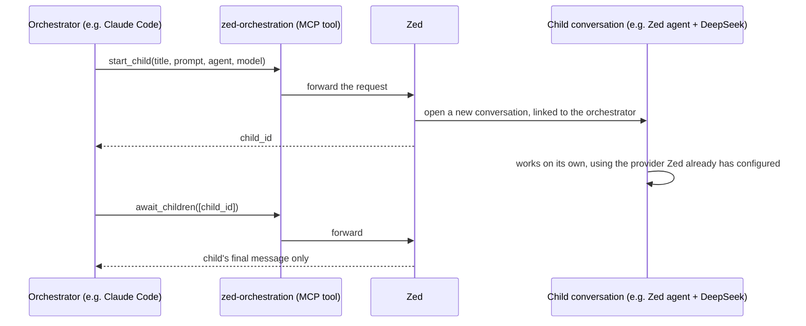

# How an agent opens a child conversation

> Companion to `orchestrated-threads.md` and `orchestrated-threads-r1-plan.md`. It explains the flow in plain terms and answers one question: **does the orchestrating agent ever get access to a key?** It does not.

## In one sentence

The orchestrating agent asks Zed to open a conversation. Zed opens it with the agent and model that were asked for, exactly as if you had clicked "New thread". The orchestrator gets back only an id and, later, the child's final answer.

## The flow

1. **Zed gives every agent conversation a tool called `zed-orchestration`.** For the native Zed agent it is a built-in tool. For an external agent such as Claude Code, Zed adds it to the list of MCP servers that it already passes to the agent at session start. To the agent, it is just one more tool.
2. **The agent calls `start_child`** with a title, a prompt and, optionally, an agent and a model.
3. **Zed opens the conversation itself,** using the same code path as the "New thread" button. The new conversation is stored with a link to its orchestrator, which is how the sidebar nests it.
4. **The child runs inside Zed.** Its model calls go through the provider configuration that Zed already holds: the Ollama endpoint, the Claude Code login, your API keys in Zed's settings. The orchestrator is not involved in those calls.
5. **The orchestrator asks for results** with `await_children` or `child_status`, and receives only the final message or a status. The full transcript stays in Zed, where you open it from the sidebar.

## What the orchestrating agent can and cannot see

| The orchestrator sees | The orchestrator never sees |
| :-- | :-- |
| The tool names and their inputs and outputs | Any provider API key or login token (Anthropic, Google, OpenAI, Ollama…) |
| The child's id, title, agent, model and status | The child's internal tool calls and transcript |
| The child's final message | Zed's settings, keychain or credential storage |

Provider keys never leave Zed's own provider layer. Opening a child does not copy, pass or expose them. It is exactly opening a conversation.

## The "token" in the plan is not a key

The plan mentions a per-session token (`ZED_ORCH_TOKEN`). It is **not** a provider credential. It is only a label that tells Zed which conversation is calling the tool, so that:
- a new child is attached to the right orchestrator in the sidebar;
- later on, sibling messages (R3b) and the subagent quota (R6) know who is asking.

Its properties:
- **It grants nothing outside the orchestration tool.** With it, a caller can only open, message, check or cancel children of that one orchestrator.
- **It is local.** The tool talks to Zed through a socket in a private temporary folder (permissions 0700) on your machine. Nothing listens on the network.
- **It is short-lived.** It is minted when the session starts and is useless once Zed or the session closes.
- **It is not part of the conversation.** It sits in the environment of the small bridge process that the agent starts for the tool, never in a prompt or a tool argument. A model with shell access on the same machine could still read it from that process's environment (`ps eww`). That would only let it act on its own orchestrator's children, which it can already do through the tool.

## Why there is a bridge process at all

External agents can only talk to MCP servers through stdio (a child process) or HTTP. Zed's built-in MCP server listens on a local socket. A small hidden mode of the Zed binary, `zed --orchestration-bridge <socket>`, connects the two: the agent starts it as an ordinary MCP server, and it relays messages to Zed. It carries no logic and no credentials of its own.
