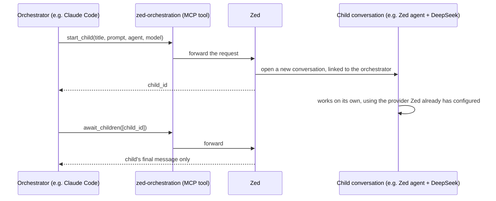

# How an agent opens a child conversation

> Companion to `orchestrated-threads.md` and `orchestrated-threads-r1-plan.md`. It explains the flow in plain terms and answers one question: **does the orchestrating agent ever get access to a key?** It does not. State described: code at `bd64c7b`.

## In one sentence

The orchestrating agent asks Zed to open a conversation. Zed opens it with the agent and model that were asked for, exactly as if you had clicked "New thread". The orchestrator gets back only an id and, later, the child's final answer.

## The flow

1. **Zed gives every agent conversation a tool called `zed-orchestration`.** For the native Zed agent it is a built-in tool. For an external agent such as Claude Code, Zed adds it to the list of MCP servers that it already passes to the agent at session start. To the agent, it is just one more tool.
2. **The agent calls `start_child`** with a title, a prompt and, optionally, an agent and a model.
3. **Zed opens the conversation itself,** using the same code path as the "New thread" button. The new conversation is stored with a link to its orchestrator, which is how the sidebar nests it.
4. **The child runs inside Zed.** Its model calls go through the provider configuration that Zed already holds: the Ollama endpoint, the Claude Code login, your API keys in Zed's settings. The orchestrator is not involved in those calls.
5. **The orchestrator asks for results** with `await_children` or `child_status`, and receives only the final message or a status. The full transcript stays in Zed, where you open it from the sidebar.

## What the orchestrating agent can and cannot see

| The orchestrator sees | The orchestrator never sees |
| :-- | :-- |
| The tool names and their inputs and outputs | Any provider API key or login token (Anthropic, Google, OpenAI, Ollama…) |
| The child's id, title, agent, model and status | The child's internal tool calls and transcript |
| The child's final message | Zed's settings, keychain or credential storage |

Provider keys never leave Zed's own provider layer. Opening a child does not copy, pass or expose them. It is exactly opening a conversation.

## The "token" in the plan is not a key

The plan mentions a per-session token (`ZED_ORCH_TOKEN`). It is **not** a provider credential. It is only a label that tells Zed which conversation is calling the tool, so that:
- a new child is attached to the right orchestrator in the sidebar;
- sibling messages (R3b) and the subagent quota (R6) know who is asking: the token maps to a thread, and a child is found by its thread.

Its properties:
- **It grants nothing outside the orchestration tool.** With it, a caller can only open, message, check or cancel children of that one orchestrator.
- **It is local.** The tool talks to Zed through a socket in a private temporary folder (permissions 0700) on your machine. Nothing listens on the network.
- **It is short-lived.** It is minted when the session starts and is useless once Zed or the session closes. When the thread is deleted, Zed also revokes the tokens of its session, so that connection can no longer call the tools.
- **It is not part of the conversation.** It sits in the environment of the small bridge process that the agent starts for the tool, never in a prompt or a tool argument. A model with shell access on the same machine could still read it from that process's environment (`ps eww`). That would only let it act on its own orchestrator's children, which it can already do through the tool.

## Why there is a bridge process at all

External agents can only talk to MCP servers through stdio (a child process) or HTTP. Zed's built-in MCP server listens on a local socket. A small hidden mode of the Zed binary, `zed --orchestration-bridge <socket>`, connects the two: the agent starts it as an ordinary MCP server, and it relays messages to Zed. It carries no logic and no credentials of its own.

## Messages between a child and its orchestrator

A child can write to its orchestrator while it works, with `send_to_parent(message, urgent?)`.

- The message goes into an **inbox** and into the child's log (`to_parent`). Nothing is added to the orchestrator's conversation yet.
- The orchestrator receives it as `pending_messages` the next time it calls `await_children` or `child_status`, and only once.
- With `urgent: true`, Zed also adds it to the orchestrator's thread as a new message, but only when the orchestrator is idle. It never interrupts a turn that is running. If the orchestrator is blocked in `await_children`, an urgent message ends that wait early.
- Every child starts with a short header that says it is a child, who its orchestrator is, and how to reach it. The `whoami` tool tells any thread its role, its parent and its children.

Why: the orchestrator hears about a blocker without its context filling up and without being interrupted.

## Messages between siblings

Children of the same orchestrator can talk to each other directly. `list_siblings` shows the others (id, title, agent, model, status) and `send_to_sibling` sends one a message.

- The message is added to the receiving child as a new message prefixed `[from sibling <title>]`, only when that child is idle. A busy child gets it when its turn ends. A child that is not loaded (after a restart) is opened first.
- Both children's logs record it (`to_sibling` and `from_sibling`). The orchestrator's conversation receives nothing. It only sees a count, `sibling_messages`, in `child_status`.
- With `await_reply`, the sender waits for the sibling's next `send_to_sibling` addressed to it, up to a timeout (120 seconds by default). If two children would wait on each other, the second gets an error instead of hanging.
- `agent.orchestration.max_sibling_messages` (default 20) caps the messages per pair, so two children cannot loop forever.

Sibling messages carry text only. They give no access to another child's tools, files or credentials.

## What happens when a human steps into a child

The human can type in a child like in any thread. Those messages are **never logged and never sent to the orchestrator**. Instead, the next time the orchestrator calls `await_children` or `child_status`, Zed writes one short summary of what the human changed and why (with the thread summary model, capped by `agent.orchestration.human_summary_max_chars`, 600 by default) and returns it once as `human_interventions`. Only the summary is logged (`human_intervention`). No model is called if the orchestrator never asks. If no summary model is set, the orchestrator gets a minimal note with the number of human turns.

## Subagent quota

When it starts a child, the orchestrator grants it a `subagent_quota` (0 by default): how many subagents or children of its own the child may start. It is a counter, not a permission. It grants nothing beyond that: a child with quota 3 can do nothing more than a child with quota 0, except start up to 3 subagents.

Zed enforces it in layers:
- **Zed's own tools** (`spawn_agent`, `start_child`, `create_thread`) are counted per child, and the one over the quota is refused with an error.
- **Claude Code children** are configured when Zed creates their session. With quota 0, Zed disallows Claude Code's `Agent` and `Task` tools. With quota N, Zed passes a small command hook that runs before each `Agent` or `Task` call. The hook has nothing to read except a **ticket directory** that Zed creates next to the child's log, with N empty files. Each call takes one file; when none is left, the hook exits with code 2 and the call is denied. The hook command contains only that directory path, no token and no key.
- **Other ACP agents** cannot be blocked in advance. Zed watches the subagents the agent announces, and cancels the ones over the quota when the agent allows cancelling. If it does not, the event is only logged.
- The child's header also states the quota.

`child_status` shows the quota granted and used, and the child's log records the grant, each spawn counted or refused, and each cancellation. Limits of this mechanism are listed in section 12 of the spec.

## Permission requests from children

When a child needs permission for a tool call, a card appears in the **orchestrator's** thread, above the orchestrator's own permission prompts. It names the child, its agent and model, the tool and a short view of the input. Buttons: Allow, Allow always (when offered), Deny, and Open to go to the child. The answer goes to the child as if the human had answered there. Zed never answers for the human, and a child's request is shown only in its own orchestrator.
